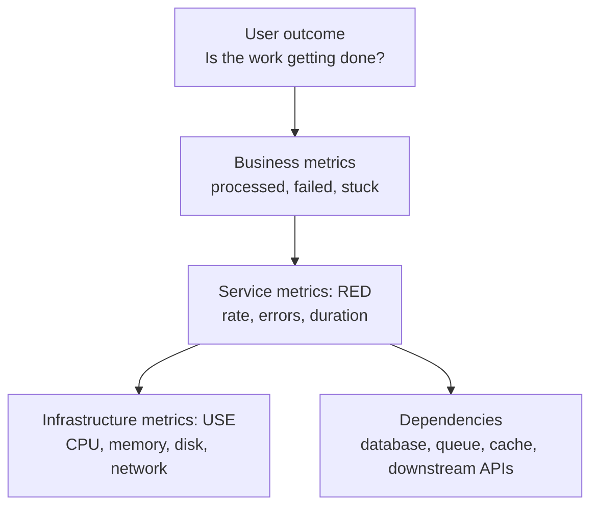

# What to Measure: Golden Signals, RED, and USE

"What should we monitor?" is the wrong first question. It leads to dashboards with 80 graphs and no answers.

A better one: **what does a user need from this service to consider it working?**

Three frameworks answer that question in a structured way. They are short, widely used, and complementary:

| Framework | Origin | Applies to | The idea in one line |
|---|---|---|---|
| **Four Golden Signals** | Google SRE book | Any user-facing system | Latency, traffic, errors, saturation |
| **RED** | Tom Wilkie (Weaveworks) | Services (APIs, microservices) | Rate, errors, duration |
| **USE** | Brendan Gregg | Resources (CPU, memory, disk, network) | Utilization, saturation, errors |

> Metric names in the queries below are examples. Your own metric names depend on what your exporters, frameworks, and applications actually expose. Check the `/metrics` page first.

---

## 1. The Four Golden Signals

If you can only measure four things about a user-facing system, measure these.

| Signal | Question it answers | Example |
|---|---|---|
| **Latency** | How long do requests take? | p99 response time is 800 ms |
| **Traffic** | How much demand is the system handling? | 50 requests per second |
| **Errors** | How many requests fail? | 2% of requests return 5xx |
| **Saturation** | How "full" is the system? | Queue depth, CPU throttling, consumer lag |

Two details people often miss:

- **Separate the latency of successful and failed requests.** A fast error can make average latency look better while users are suffering. Failed requests that hang for 30 seconds distort the other way.
- **Saturation predicts problems before errors appear.** A queue that is growing, or a container being CPU-throttled, is a warning. The errors come later.

---

## 2. RED: for services

RED is the golden signals trimmed to what you can measure for any request-driven service.

| Letter | Meaning | Question |
|---|---|---|
| **R** | Rate | How many requests per second? |
| **E** | Errors | How many of them fail? |
| **D** | Duration | How long do they take? |

Example queries (assuming standard HTTP metrics exist):

```promql
# Rate: requests per second
sum(rate(http_requests_total[5m]))

# Errors: share of requests returning 5xx
sum(rate(http_requests_total{status=~"5.."}[5m]))
/
sum(rate(http_requests_total[5m]))

# Duration: p99 latency from a histogram
histogram_quantile(0.99,
  sum by (le) (rate(http_request_duration_seconds_bucket[5m])))
```

**Why RED works well:** every service gets the same three graphs in the same layout. Whoever is on call can read any service's dashboard without learning it first.

**What RED does not show:** saturation. That is the gap the fourth golden signal fills.

---

## 3. USE: for resources

USE applies to things that get used up: CPU, memory, disks, network interfaces.

| Letter | Meaning | Question |
|---|---|---|
| **U** | Utilization | How busy is the resource? |
| **S** | Saturation | How much work is waiting because the resource is full? |
| **E** | Errors | Is the resource reporting failures? |

Example mapping with Node Exporter metrics:

| Resource | Utilization | Saturation | Errors |
|---|---|---|---|
| **CPU** | CPU busy % | Load average relative to core count, or run queue | Rarely applicable |
| **Memory** | Used % | Swap activity, major page faults | OOM kills |
| **Disk** | I/O busy time | I/O queue length | Disk errors |
| **Network** | Bandwidth used vs capacity | Dropped packets, overruns | Receive and transmit errors |

```promql
# CPU utilization (%)
100 - (avg by (instance) (rate(node_cpu_seconds_total{mode="idle"}[5m])) * 100)

# Disk utilization: fraction of time the disk was busy
rate(node_disk_io_time_seconds_total[5m])

# Network errors
rate(node_network_receive_errs_total[5m])
```

Use **USE for infrastructure** and **RED for services**. Together they show both what users experience and what the machines are doing.

---

## 4. The layer most teams miss: business metrics

RED and USE are technical. A service can pass every technical check and still fail at its actual job.

Example: a bug causes a trade-processing service to accept requests but never complete settlement.

| Layer | What the dashboard shows |
|---|---|
| **Infrastructure (USE)** | CPU normal, memory normal, disk normal |
| **Service (RED)** | Requests succeed, errors near 0%, latency normal |
| **Business** | Trades settled in the last hour: **0** |

Only the third layer shows the problem. Typical business metrics:

- Items received, processed, and failed
- Items stuck or pending past a deadline
- Reconciliation mismatches
- Value or count processed per hour
- Jobs that missed their scheduled completion time

**Only the application knows what its work means.** That means these metrics have to be instrumented inside the application, for example with a Prometheus client library or Micrometer. Exporters and framework metrics cannot produce them.

---

## 5. Put the layers together



A practical way to read a dashboard top-down:

1. **Business layer:** is the work being completed?
2. **Service layer (RED):** are requests failing or slow?
3. **Dependencies:** is a database, queue, or downstream service the cause?
4. **Infrastructure (USE):** is a resource saturated?

---

## 6. Use percentiles, not averages

Averages hide the experience of your unluckiest users.

If 99 requests take 100 ms and 1 request takes 30 seconds, the average is about 400 ms and looks acceptable. The p99 shows the 30-second request.

- Record latency as a **histogram**, not an average.
- Look at **p95 and p99**, and p50 (the median) for the typical case.
- **Never average percentiles from different instances.** Aggregate the histogram buckets first, then calculate the percentile (as the `histogram_quantile` query above does).

---

## 7. Common mistakes

| Mistake | Why it hurts | Better approach |
|---|---|---|
| Monitoring only infrastructure | Servers look healthy while the application fails | Add RED and business metrics |
| Using averages for latency | Hides slow requests | Use p95 and p99 from histograms |
| Skipping saturation | You only learn about trouble when errors begin | Track queue depth, throttling, and lag |
| Every metric on the main dashboard | Nobody can find the signal | Put signals first, details below |
| Different layouts for every service | On-call has to relearn each one | Standardize one RED dashboard template |
| High-cardinality labels (user ID, request ID) | Overloads the metrics system | Keep labels to small, bounded sets |
| Tracking metrics nobody acts on | Cost and noise with no benefit | Ask: "If this changed, would someone do something?" |

---

## 8. Checklist for a new service

- [ ] **Rate, errors, and duration** for each main endpoint (RED)
- [ ] **Latency as a histogram**, viewed as p95 and p99
- [ ] **Saturation signals**: queue depth, thread or connection pool usage, CPU throttling, consumer lag where relevant
- [ ] **Dependency health**: database, cache, queue, downstream calls
- [ ] **Resource metrics** for the hosts or containers (USE)
- [ ] **Business metrics**: processed, failed, stuck, and deadline-based measures
- [ ] **One standard dashboard** with signals at the top and detail below
- [ ] **Alerts on symptoms** (user impact), not only on causes

---

## Further reading

- Google SRE Book, *Monitoring Distributed Systems* (source of the four golden signals): https://sre.google/sre-book/monitoring-distributed-systems/
- Brendan Gregg, *The USE Method*: https://www.brendangregg.com/usemethod.html
- Prometheus documentation, *Histograms and summaries*: https://prometheus.io/docs/practices/histograms/
- Tom Wilkie's original write-up on the RED method (search for "The RED Method: How to Instrument Your Services")

*Last verified: 16 November 2026. Links and metric names may change, so check the official documentation.*
