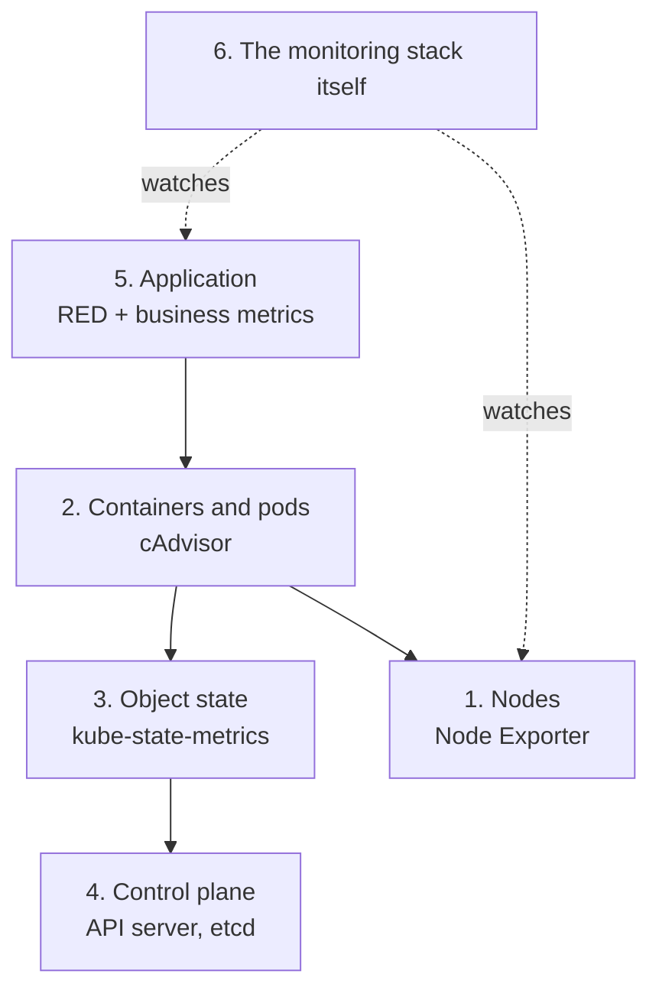
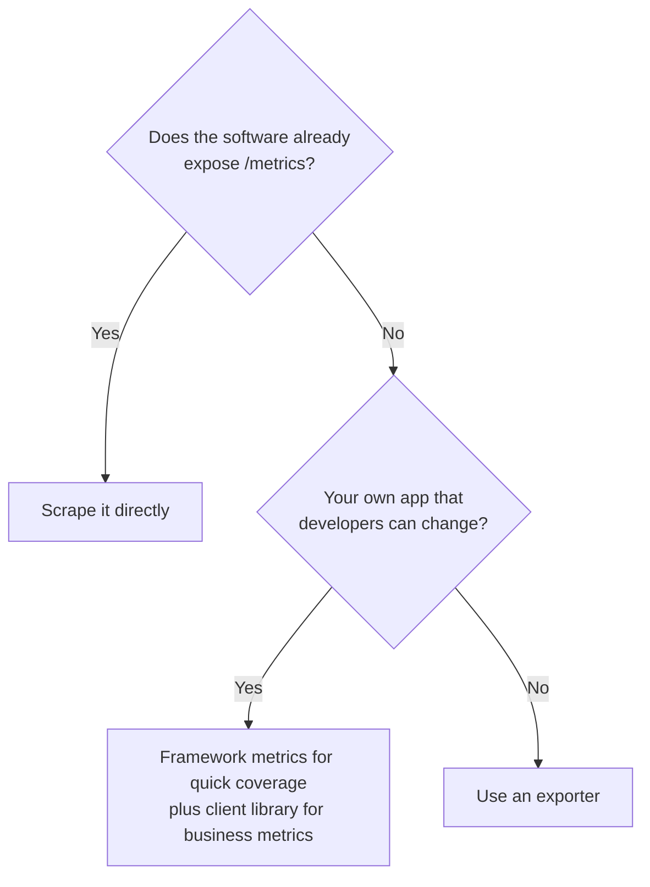

# Kubernetes Metrics: What to Collect and How to Collect It

"Monitor the cluster" means several different things on Kubernetes. Most teams stop at node CPU and memory and miss the layers where problems actually start.

This page covers:

1. The **kinds of metrics** you will see
2. The **six layers** worth collecting on Kubernetes
3. **How each layer is collected**
4. The **ways to collect application metrics**
5. **How Prometheus finds and scrapes** all of it
6. A **troubleshooting map** from symptom to layer

> Metric names and chart contents change between versions and Kubernetes distributions. Check what your own environment exposes before relying on a query.

---

## 1. Kinds of metrics

### By behavior

| Type | Behavior | Example | How to query |
|---|---|---|---|
| **Counter** | Only goes up, resets on restart. Name usually ends in `_total` | `node_cpu_seconds_total` | `rate()`, `increase()` |
| **Gauge** | Goes up and down | memory available, queue size | Use directly |
| **Histogram** | Counts observations in buckets (`_bucket`, `_sum`, `_count`) | request duration | `histogram_quantile()` |

Never graph a raw counter. Use `rate()` for speed per second or `increase()` for growth over a period.

### By what they describe

| Layer of concern | Method | Question |
|---|---|---|
| Resources (nodes, containers) | **USE**: utilization, saturation, errors | Is the resource busy or full? |
| Services | **RED**: rate, errors, duration | Are requests succeeding quickly? |
| Business | Custom | Is the real work getting done? |

---

## 2. The six layers



| # | Layer | Tells you | Collected by |
|---|---|---|---|
| 1 | **Nodes** | CPU, memory, disk, network of each machine | Node Exporter (DaemonSet) |
| 2 | **Containers and pods** | Resource use and throttling per container | cAdvisor (built into the kubelet) |
| 3 | **Object state** | What the cluster believes should exist | kube-state-metrics |
| 4 | **Control plane** | Health of the API server, etcd, scheduler | Their own `/metrics` endpoints |
| 5 | **Application** | RED and business metrics | Client library, framework metrics, exporters |
| 6 | **Monitoring stack** | Whether your monitoring still works | Prometheus, Alertmanager, log shipper metrics |

---

## 3. Layer by layer

### Layer 1: Nodes (Node Exporter)

Runs on every node, usually as a DaemonSet. It reports the operating system's view of the machine.

```promql
# Memory used (%)
100 * (1 - node_memory_MemAvailable_bytes / node_memory_MemTotal_bytes)

# CPU used (%) per node
100 - (avg by (instance) (rate(node_cpu_seconds_total{mode="idle"}[5m])) * 100)

# Root filesystem used (%)
100 * (1 - node_filesystem_avail_bytes{mountpoint="/"} / node_filesystem_size_bytes{mountpoint="/"})
```

**Watch for:** disks filling up, memory pressure, sustained high load.

**Predict disk exhaustion:**

```promql
predict_linear(node_filesystem_avail_bytes{mountpoint="/"}[6h], 4*3600) < 0
```

### Layer 2: Containers and pods (cAdvisor)

cAdvisor is built into the kubelet and reports resource use per container.

```promql
# Memory in use per pod
sum by (namespace, pod) (container_memory_working_set_bytes{container!=""})

# CPU use per pod (cores)
sum by (namespace, pod) (rate(container_cpu_usage_seconds_total{container!=""}[5m]))

# CPU throttling: share of periods where the container hit its CPU limit
sum by (namespace, pod) (rate(container_cpu_cfs_throttled_periods_total[5m]))
/
sum by (namespace, pod) (rate(container_cpu_cfs_periods_total[5m]))
```

**Watch for:**
- Memory close to the container's limit, which risks an OOM kill
- High throttling with low average CPU. The limit is too tight, even though the node looks fine.

This is also the data to use when **right-sizing** requests and limits.

### Layer 3: Object state (kube-state-metrics)

kube-state-metrics reads the Kubernetes API and reports the *state* of objects. It does not measure resource usage.

```promql
# Containers restarting
increase(kube_pod_container_status_restarts_total[1h]) > 3

# Pods stuck in Pending, by namespace
sum by (namespace) (kube_pod_status_phase{phase="Pending"})

# Deployments with unavailable replicas
kube_deployment_status_replicas_unavailable > 0

# Nodes that are not Ready
kube_node_status_condition{condition="Ready", status="true"} == 0
```

**Watch for:** crash loops, Pending pods, deployments below their desired replica count, NotReady nodes.

### Layer 4: Control plane

The control plane (API server, etcd, scheduler, controller manager) exposes its own metrics.

```promql
# API server p99 latency by verb (excluding long-running WATCH requests)
histogram_quantile(0.99,
  sum by (le, verb) (rate(apiserver_request_duration_seconds_bucket{verb!="WATCH"}[5m])))

# etcd has no leader
etcd_server_has_leader == 0
```

**Watch for:** slow API server responses (every controller and `kubectl` command depends on them) and etcd trouble.

> **Managed Kubernetes (EKS, GKE, AKS):** the provider runs parts of the control plane, and you may not be able to scrape etcd, the scheduler, or the controller manager directly. Check your provider's documentation for what is exposed.

### Layer 5: Applications

Rate, errors, and duration, plus business metrics. See section 4 for the ways to collect them.

### Layer 6: The monitoring stack itself

If monitoring goes quiet, you may not notice. Monitor the monitors.

```promql
# Any scrape target down
up == 0

# Rule evaluation failures in Prometheus
rate(prometheus_rule_evaluation_failures_total[5m]) > 0

# Alertmanager failing to deliver notifications
rate(alertmanager_notifications_failed_total[5m]) > 0
```

Also watch Prometheus storage and series count, your log shipper (dropped or retried records), and your log store's health (disk, cluster status).

---

## 4. Ways to collect application metrics

Prometheus **pulls** from a `/metrics` page. The question is who creates that page.

| Way | Code change? | Business metrics? | Best for | Tools |
|---|---|---|---|---|
| **Client library** | Yes | **Yes** | Your own app, business numbers | Prometheus client libraries (Python, Go, Java, .NET, Node.js), Micrometer |
| **Framework built-in** | Small setting | No | Quick RED coverage | Spring Boot Actuator with Micrometer, FastAPI, Flask, Django, ASP.NET |
| **Exporter** | None | No | Software you did not build | Kafka, database, Redis, JMX, Blackbox exporters |
| **OpenTelemetry** | SDK: yes. Agent: no | SDK: yes. Agent: no | When you also want traces, or vendor neutrality | OTel SDK or agent, OTel Collector |
| **Derived from logs** | None | Limited | A stopgap for apps you cannot change | Log-to-metrics filters, mtail, Loki recording rules |
| **Service mesh / eBPF** | None | No | Uniform metrics between services | Istio, Linkerd, Envoy, Beyla |
| **Push** | Sometimes | Possibly | Short batch jobs | Pushgateway, StatsD |

### Choosing



### Examples

**Client library (Python):**

```python
from prometheus_client import Counter, start_http_server

TRADES = Counter("trades_processed", "Trades processed", ["status"])
start_http_server(8000)   # serves /metrics on port 8000

TRADES.labels(status="success").inc()
```

**Framework (Spring Boot):**

```properties
management.endpoints.web.exposure.include=health,prometheus
```

Metrics appear at `/actuator/prometheus` once the Actuator and Micrometer Prometheus registry dependencies are added.

**Exporter (JMX Exporter for a Java app):**

```
java -javaagent:/opt/jmx_prometheus_javaagent.jar=9404:/opt/config.yaml -jar app.jar
```

---

## 5. How Prometheus finds and scrapes everything

Prometheus visits each target's `/metrics` page at a fixed interval (a **scrape**). On Kubernetes you tell it what to scrape in one of three ways:

| Method | Where it is used |
|---|---|
| **ServiceMonitor** or **PodMonitor** | Clusters running the Prometheus Operator (the usual approach) |
| **Static configuration** | `prometheus.yml` with `static_configs` |
| **Annotations** | Only if your Prometheus configuration contains rules that read them |

**ServiceMonitor example:**

```yaml
apiVersion: monitoring.coreos.com/v1
kind: ServiceMonitor
metadata:
  name: trade-app
  labels:
    release: kube-prometheus-stack   # must match your Prometheus's selector
spec:
  selector:
    matchLabels:
      app: trade-app                 # must match the Service's labels
  endpoints:
    - port: metrics                  # the NAME of the Service port
      path: /metrics
      interval: 15s
```

Three things must line up: the Service's labels, a **named** Service port, and the label your Prometheus is configured to select.

**Always verify:** in Prometheus open **Status → Targets** and confirm the target shows **UP**.

### A common starting point

The **kube-prometheus-stack** Helm chart installs much of layers 1 to 4 and 6 together: the Prometheus Operator, Prometheus, Alertmanager, Grafana, Node Exporter, kube-state-metrics, kubelet and cAdvisor scraping, and ready-made dashboards. You then add ServiceMonitors for your own applications. What it deploys and which control plane targets work depends on the chart version and your cluster, so check the result.

---

## 6. Troubleshooting map: symptom to layer

| Symptom | Look first at |
|---|---|
| Pod keeps restarting | Layer 3 (restarts, last termination reason), layer 2 (memory vs limit) |
| App slow, but CPU looks fine | Layer 2 (CPU throttling) |
| Pod stuck in Pending | Layer 3 (Pending pods), node capacity (layer 1) |
| Node reported NotReady | Layers 1 and 3 |
| `kubectl` is slow | Layer 4 (API server, etcd) |
| Business numbers drop but errors are zero | Layer 5 (business metrics) |
| Dashboards suddenly empty | Layer 6 (is Prometheus scraping?) |
| Alerts did not fire during an incident | Layer 6 (rule evaluation, Alertmanager delivery) |

A useful habit is to work **top-down** (application first) or **bottom-up** (nodes first) rather than guessing.

---

## 7. Good practice

- Name metrics with underscores and units (`_seconds`, `_bytes`), with `_total` for counters.
- Keep labels low-cardinality. Never use user IDs, request IDs, or raw URLs as labels.
- Use histograms for latency and read p95 and p99, not averages.
- Alert on symptoms, and on missing data (`up == 0`, `absent()`).
- Collect what a dashboard or alert will use. More metrics means more cost.
- Use a read-only account for exporters that connect to databases, and store credentials as secrets.

---

## 8. Checklist for a new cluster

- [ ] Node Exporter on every node
- [ ] cAdvisor and kube-state-metrics scraped
- [ ] Control plane metrics scraped where the platform allows it
- [ ] A ServiceMonitor for each application, with the target showing **UP**
- [ ] RED dashboard per service, in one standard layout
- [ ] Business metrics added by developers where the work has meaning
- [ ] Alerts on symptoms, with runbook links
- [ ] Alerts for the monitoring stack itself

---

## Further reading

- Prometheus documentation: https://prometheus.io/docs/
- Kubernetes documentation, *Metrics for Kubernetes system components*: https://kubernetes.io/docs/concepts/cluster-administration/system-metrics/
- kube-state-metrics project: https://github.com/kubernetes/kube-state-metrics
- Node Exporter project: https://github.com/prometheus/node_exporter
- kube-prometheus-stack chart: https://github.com/prometheus-community/helm-charts

*Last verified: 21 November 2026. Metric names, chart contents, and links change over time, so confirm against the official documentation before copying configuration.*
